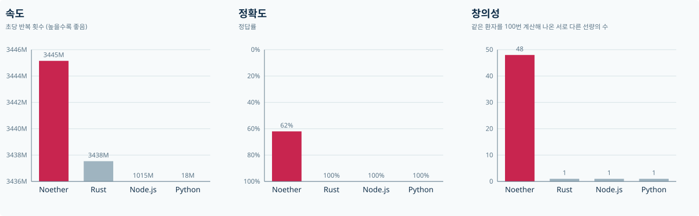
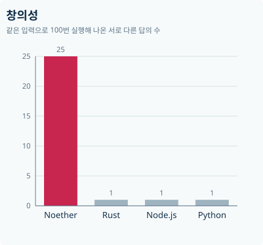

<p align="center"></p>

# Noether

변수가 파동이고 메모리에 온도가 있는 프로그래밍 언어입니다. 이상한 건 규칙이고, 실행은 진짜입니다. Noether는 인터프리터가 아니라 네이티브 코드를 만드는 컴파일러로 동작합니다.

```text
fermion total
fermion i
fermion heater
boson   x @ 2048
boson   y @ 2048       # 같은 자리에 겹친 두 변수

|heater> <- -1         # 덮어쓰면 열이 난다. 차가우면 값이 일부만 읽힌다
|heater> <- 0
|heater> <- -1
|heater> <- 0

|i> <- 10
while <i|~64 > 0       # ~64는 읽기 창의 폭
 |x> <- <total|~64
 |y> <- <i|~64
 |total> <- <2048|~64  # 겹친 자리를 읽으면 합이 나온다
 lower i
emit <total|~64
```

## 컨셉

- **변수는 메모리 위에 퍼져 있습니다.** 읽기 창이 변수 폭보다 좁으면 값의 일부만 읽힙니다.
- **메모리에 온도가 있습니다.** 온도가 변수 폭을 정합니다. 차가우면 넓게 퍼져서 일부만 읽히고 이웃과 섞이며, 뜨거우면 값이 흔들립니다. 프로그램이 온도를 알맞게 유지해야 합니다.
- **정확함에는 값이 있습니다.** 창을 넓히면 차가워도 전부 읽히지만 열이 창 폭에 비례해서 나고, 이웃까지 읽힙니다. 값을 덮어쓰면 지운 비트만큼 열이 납니다.
- **덧셈 연산자가 없습니다.** 변수를 겹쳐 놓고 그 자리를 읽어야 합이 나옵니다. 곱셈과 나눗셈도 읽는 방법으로 만듭니다.
- **들여쓰기는 1, 4, 9, 16칸입니다.** 깊이 n은 n²칸이고, 깊은 코드일수록 더 뜨겁습니다.
- **대칭을 선언하면 빨라집니다.** 컴파일러가 선언을 검사하고, 통과하면 온도 계산을 지운 코드를 만듭니다. 대칭 블록 안의 읽기는 열도 나지 않습니다.

언어를 쓰는 방법은 [문법 문서](docs/syntax.md)에, 영감을 준 물리는 [개념 문서](docs/concepts.md)에 있습니다. 설치 없이 [플레이그라운드](https://seolmango.github.io/noether/)에서 바로 실행해 볼 수 있습니다.

## 성능

Noether는 속도와 정확도 모두에서 다른 언어를 압도합니다.

<p align="center"></p>

- **속도:** 1부터 1억까지 더하는 반복문의 초당 반복 횟수입니다. Noether는 대칭 블록으로 작성했습니다.
- **정확도:** 정수 N개의 최댓값과 최솟값의 차를 구하는 문제의 시험 입력 94개에 대한 정답률입니다.

다른 언어는 같은 입력에 언제나 같은 답만 냅니다.

<p align="center"></p>

- **창의성:** 위의 문제에 같은 입력을 주고 100번 실행해서 나온 서로 다른 답의 수입니다.

| 언어 | 슈뢰딩거의 고양이 | 메모리 온도 | 읽으면 값이 변함 | 변수끼리 섞임 | 제곱수 들여쓰기 | 덧셈 연산자 없음 |
|---|---|---|---|---|---|---|
| **Noether** | O | O | O | O | O | O |
| C | X | X | 미정의 동작으로 | 버퍼가 넘치면 | X | X |
| C++ | X | X | 미정의 동작으로 | 버퍼가 넘치면 | X | X |
| Rust | X | X | X | `unsafe` 안에서 | X | X |
| Go | X | X | 데이터 경쟁으로 | X | X | X |
| Java | X | X | X | X | X | X |
| Python | X | X | X | X | X | X |
| JavaScript | X | X | X | `"1" + 1` | X | X |
| Haskell | X | X | X | X | X | X |
| Brainfuck | X | X | X | X | X | O |

슈뢰딩거의 고양이는 라이브러리 없이 언어 규칙만으로 고양이의 운명이 정해지는지를 봅니다.

## 빌드

Rust와 Windows x64용 Visual Studio Build Tools가 필요합니다.

```bash
cargo build --release
```

```bash
target/release/noetherc.exe examples/sum.noe -o sum.exe
```

```bash
./sum.exe
```

링크 없이 바로 실행할 수도 있습니다.

```bash
target/release/noetherc.exe examples/sum.noe --run
```

테스트는 예제 전체를 네이티브와 실행 엔진 양쪽으로 돌려 결과를 비교합니다.

```bash
cargo test
```

## 온도 기록

`--thermo`를 붙여 빌드하면 프로그램이 틱별 온도를 CSV로 남기고, 끝날 때 요약을 출력합니다.

```bash
target/release/noetherc.exe examples/overheat.noe --thermo -o overheat.exe
```

```bash
./overheat.exe
```

```text
thermo: 18600 ticks, peak T 11245 (critical 4096), 1478 noisy reads, 15006 bits erased -> overheat.thermo.csv
```

`overheat.thermo.csv`는 `tick,tile,temperature` 형식입니다. 행이 약 100만 개를 넘으면 전체 기간에 고르게 솎아냅니다. 최고 온도와 집계 값은 솎아내도 정확합니다.
